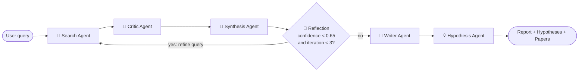
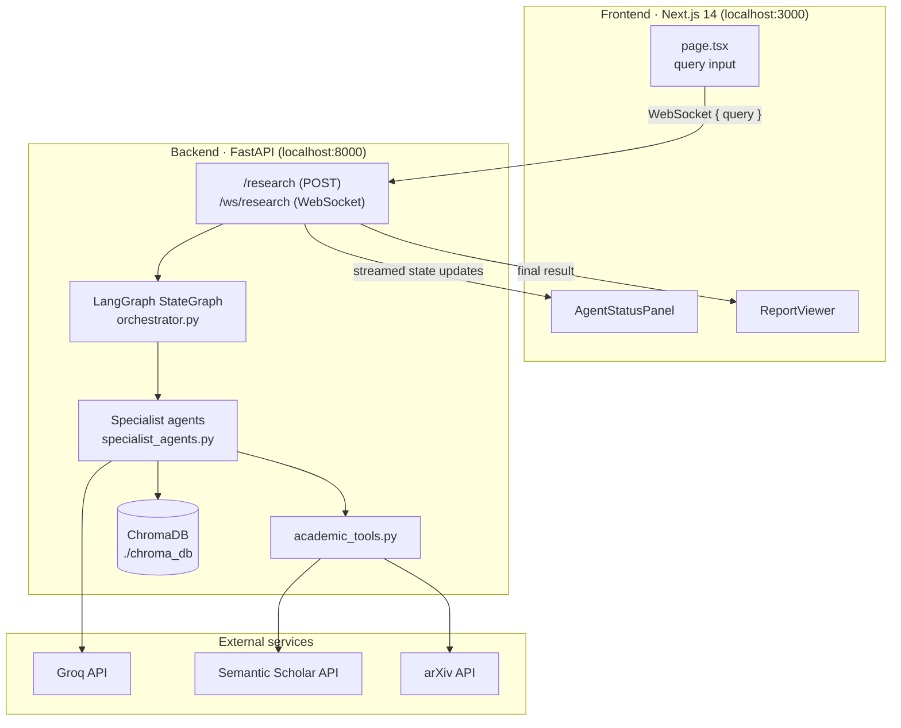

<div align="center">

# 🔬 MARA — Multi-Agent Research Assistant

**Ask a research question. A team of AI agents finds the papers, critiques them, synthesizes the evidence, writes the report, and proposes new hypotheses.**


</div>

---

## 📖 Table of Contents

- [Overview](#-overview)
- [Features](#-features)
- [How It Works](#-how-it-works)
- [Architecture](#-architecture)
- [Tech Stack](#-tech-stack)
- [Project Structure](#-project-structure)
- [Getting Started](#-getting-started)
- [Configuration](#-configuration)
- [API Reference](#-api-reference)
- [Agent State](#-agent-state)
- [Known Issues](#-known-issues)
- [Roadmap](#-roadmap)
- [Contributing](#-contributing)
- [License](#-license)

---

## 🧭 Overview

**MARA** is a full-stack, agentic literature-review tool. Instead of one large prompt, it splits research into a pipeline of specialist agents — **Search → Critic → Synthesis → Reflection → Writer → Hypothesis** — orchestrated as a state graph with [LangGraph](https://github.com/langchain-ai/langgraph) and powered by fast LLM inference on **Groq** (`openai/gpt-oss-120b` by default).

Papers are pulled live from **Semantic Scholar** and **arXiv**, embedded into a local **ChromaDB** vector store, and every step is streamed to a **Next.js** dashboard over WebSockets, so you can watch the agents work in real time.

> **Example query:** *"Effectiveness of retrieval-augmented generation for reducing LLM hallucinations"*
> → 5 curated papers, a scored critique of each, a confidence-rated synthesis, a cited Markdown report, and a list of open research gaps with new hypotheses.

---

## ✨ Features

| | Feature | Description |
|---|---|---|
| 🔎 | **Multi-source search** | Queries Semantic Scholar and arXiv concurrently (10 results each) and removes duplicates. |
| 🎯 | **LLM-based relevance ranking** | The LLM picks the top 5 most relevant papers from the combined pool. |
| 🧐 | **Automated peer critique** | All papers are critiqued concurrently, each with a 1–10 score. |
| 🧩 | **Evidence synthesis** | Findings are merged into one cited synthesis with a 0–1 confidence score. |
| 🔁 | **Self-reflection loop** | If confidence is below **0.65**, the LLM rewrites the search query and the graph searches again (up to **3** extra passes). |
| 📝 | **Report generation** | Produces a Markdown research report with inline citations and a References section. |
| 💡 | **Hypothesis generation** | Identifies research gaps and proposes new hypotheses. |
| 🧠 | **Semantic memory** | Selected papers are embedded (`all-MiniLM-L6-v2`) and persisted in ChromaDB. |
| ⚡ | **Live streaming** | WebSocket endpoint streams the full state after every agent step. |
| 🖥️ | **Dark-mode dashboard** | Live step tracker, confidence bar, rendered Markdown report, hypotheses and linked papers. |

---

## ⚙️ How It Works



| Agent | Input | Output |
|---|---|---|
| **Search** | `search_query` | Fetches up to 20 papers (Semantic Scholar + arXiv), the LLM selects top 5, stores them in ChromaDB → `papers` |
| **Critic** | `papers` | Critique and parsed score (1–10) per paper → `critiques` |
| **Synthesis** | `papers`, `critiques` | Cited findings and parsed confidence → `synthesis`, `confidence_score` |
| **Reflection** | `confidence_score`, `iteration` | Proceeds, or writes a better `search_query` and increments `iteration` |
| **Writer** | `synthesis`, `papers` | Markdown report with citations and references → `report` |
| **Hypothesis** | `synthesis` | Research gaps and new hypotheses → `hypotheses` |

---

## 🏗️ Architecture



---

## 🧰 Tech Stack

**Backend**
- [FastAPI](https://fastapi.tiangolo.com/) + [Uvicorn](https://www.uvicorn.org/) — REST and WebSocket API
- [LangGraph](https://github.com/langchain-ai/langgraph) — stateful multi-agent orchestration
- [langchain-groq](https://python.langchain.com/docs/integrations/chat/groq/) — Groq chat models (`openai/gpt-oss-120b` by default)
- [ChromaDB](https://www.trychroma.com/) — persistent vector store
- [sentence-transformers](https://www.sbert.net/) — `all-MiniLM-L6-v2` embeddings
- [aiohttp](https://docs.aiohttp.org/) — async HTTP calls to Semantic Scholar and arXiv
- [Pydantic](https://docs.pydantic.dev/), [python-dotenv](https://pypi.org/project/python-dotenv/)

**Frontend**
- [Next.js 14](https://nextjs.org/) (App Router) + React 18 + TypeScript
- [Tailwind CSS 3](https://tailwindcss.com/) + `@tailwindcss/typography`
- [react-markdown](https://github.com/remarkjs/react-markdown) + `remark-gfm` — safe Markdown rendering of the report

---

## 📁 Project Structure

```
mara/
├── README.md
├── .gitignore
└── MARA/
    ├── backend/
    │   ├── .env.example            # Environment variable template
    │   ├── requirements.txt        # Python dependencies
    │   ├── agents/
    │   │   ├── state.py            # AgentState, initial state, loop thresholds
    │   │   ├── specialist_agents.py# All six agents (incl. Reflection) + Groq LLM client
    │   │   └── orchestrator.py     # LangGraph graph wiring and reflection routing
    │   ├── api/
    │   │   └── main.py             # FastAPI app: GET /health, POST /research, WS /ws/research
    │   ├── memory/
    │   │   └── vector_store.py     # ChromaDB + sentence-transformers wrapper
    │   └── tools/
    │       └── academic_tools.py   # Semantic Scholar & arXiv search clients
    └── frontend/
        ├── .env.local              # NEXT_PUBLIC_WS_URL
        ├── package.json
        ├── tailwind.config.ts
        ├── app/
        │   ├── layout.tsx          # Root layout (dark theme)
        │   ├── page.tsx            # Query input + WebSocket client
        │   └── globals.css
        └── components/
            ├── AgentStatusPanel.tsx# Live status, iteration, confidence bar
            └── ReportViewer.tsx    # Tabs: Report / Hypotheses / Papers
```

---

## 🚀 Getting Started

### Prerequisites

- **Python** 3.10+
- **Node.js** 18+ and npm
- A **Groq API key** — get one free at [console.groq.com/keys](https://console.groq.com/keys)

### 1. Clone the repository

```bash
git clone https://github.com/<your-username>/mara.git
cd mara/MARA
```

### 2. Backend setup

```bash
cd backend
python -m venv .venv
```

Activate the virtual environment:

```bash
# macOS / Linux
source .venv/bin/activate
```

```bash
# Windows (PowerShell)
.venv\Scripts\Activate.ps1
```

Install dependencies and create your `.env`:

```bash
pip install -r requirements.txt
cp .env.example .env
```

Edit `backend/.env` and set your `GROQ_API_KEY`.

> 💡 The first run downloads the `all-MiniLM-L6-v2` embedding model (~90 MB).

### 3. Run the backend

The backend uses package-relative imports, so start it **from the `MARA/` directory** (not from inside `backend/`):

```bash
cd ..
uvicorn backend.api.main:app --reload --port 8000
```

The API is now at `http://localhost:8000` and interactive docs at `http://localhost:8000/docs`.

### 4. Frontend setup

In a new terminal:

```bash
cd MARA/frontend
npm install
npm run dev
```

Open **http://localhost:3000**, type a research question, and hit **Search**.

---

## 🔐 Configuration

### Backend — `MARA/backend/.env`

| Variable | Required | Description |
|---|---|---|
| `GROQ_API_KEY` | ✅ | Groq API key used by every agent. |
| `GROQ_MODEL` | ⬜ | Groq model for all agents (default `openai/gpt-oss-120b`). See [Groq models](https://console.groq.com/docs/models). |
| `SEMANTIC_SCHOLAR_API_KEY` | ⬜ | Free [Semantic Scholar key](https://www.semanticscholar.org/product/api). Without it, requests are often rate-limited (HTTP 429) and only arXiv results come back. |
| `CORS_ORIGINS` | ⬜ | Comma-separated origins allowed to call the REST API (default `http://localhost:3000`). |
| `CHROMA_DB_PATH` | ⬜ | Where ChromaDB stores data (default `MARA/backend/chroma_db`). |
| `LANGCHAIN_API_KEY` | ⬜ | Optional LangSmith key for tracing (also set `LANGCHAIN_TRACING_V2=true`). |

### Frontend — `MARA/frontend/.env.local`

| Variable | Default | Description |
|---|---|---|
| `NEXT_PUBLIC_WS_URL` | `ws://localhost:8000/ws/research` | WebSocket endpoint of the backend. |

### Tunable constants

| Setting | Location | Default |
|---|---|---|
| Confidence threshold (`CONFIDENCE_THRESHOLD`) | `backend/agents/state.py` | `0.65` |
| Max reflection iterations (`MAX_ITERATIONS`) | `backend/agents/state.py` | `3` |
| Papers kept per search (`TOP_K_PAPERS`) | `backend/agents/specialist_agents.py` | `5` |
| Results per source | `backend/tools/academic_tools.py` | `10` |
| Embedding model | `backend/memory/vector_store.py` | `all-MiniLM-L6-v2` |

> ⚠️ Never commit your real `.env`. The included `.gitignore` already excludes `.env`, `chroma_db/`, `node_modules/` and `.next/`.

---

## 📡 API Reference

### `GET /health`

Returns `{ "status": "ok" }`.

### `POST /research`

Runs the full pipeline and returns the final state in one response. The query must be 3–500 characters (otherwise HTTP 422).

```bash
curl -X POST http://localhost:8000/research \
  -H "Content-Type: application/json" \
  -d '{"query": "graph neural networks for drug discovery"}'
```

**Response** (abridged):

```json
{
  "query": "graph neural networks for drug discovery",
  "search_query": "graph neural networks for drug discovery",
  "papers": [{ "title": "...", "abstract": "...", "authors": [], "year": "2023", "url": "...", "source": "arXiv" }],
  "critiques": [{ "paper": "...", "critique": "... SCORE: 8", "score": 8.0 }],
  "synthesis": "...",
  "confidence_score": 0.8,
  "iteration": 0,
  "report": "# Report ...",
  "hypotheses": [{ "hypothesis": "...", "confidence": 0.7 }],
  "status": "Hypotheses generated"
}
```

### `WS /ws/research`

Streams the full state after each agent finishes.

1. Connect to `ws://localhost:8000/ws/research`
2. Send: `{ "query": "your research question" }`
3. Receive one message per graph step: the complete state plus the step that just ran, e.g. `{ "node": "critic", "status": "Critiqued 5 papers", "papers": [...], ... }`. The first message has `"node": "start"`.
4. The last message has `"node": "done"`, `"status": "completed"` and the full final state (report, hypotheses, papers). On failure you get `{ "error": "..." }` instead.

---

## 🧱 Agent State

All agents read and write a shared `AgentState` (`backend/agents/state.py`):

| Field | Type | Description |
|---|---|---|
| `query` | `str` | The user's research question |
| `search_query` | `str` | Search terms for the current pass (rewritten by Reflection) |
| `papers` | `List[Dict]` | Selected papers (title, abstract, authors, year, url, source) |
| `critiques` | `List[Dict]` | Per-paper critique text and parsed score |
| `hypotheses` | `List[Dict]` | Generated hypotheses with confidence |
| `synthesis` | `str` | Combined findings |
| `report` | `str` | Final Markdown report |
| `confidence_score` | `float` | 0–1, drives the reflection loop |
| `iteration` | `int` | Number of reflection loops run |
| `status` | `str` | Human-readable progress message |

---

## 🐛 Known Issues

MARA is an early-stage project. Current limitations:

- **No auth or rate limiting** — fine for local use, not for a public deployment.
- **Semantic Scholar rate limits** — without `SEMANTIC_SCHOLAR_API_KEY`, results often come from arXiv only.
- **Scores come from text parsing** — critique scores and confidence are read from `SCORE:` / `CONFIDENCE:` lines in the model's reply; if a line is missing, defaults are used (5 and 0.5).
- **Vector store is write-only** — papers are stored in ChromaDB but not yet used for retrieval in later runs.
- **No automated test suite** yet.

---

## 🗺️ Roadmap

- [x] Markdown report rendering
- [x] Query refinement on reflection loops
- [ ] Clickable `[n]` citations linked to papers
- [ ] Use the vector store for retrieval across sessions (RAG over past papers)
- [ ] Add PubMed / OpenAlex / CrossRef sources
- [ ] Structured LLM outputs (JSON / tool calling) for scores and confidence
- [ ] Export reports to PDF / BibTeX
- [ ] Docker Compose for one-command startup
- [ ] Tests (pytest for agents with mocked LLM, Playwright for UI) and CI

---

## 🤝 Contributing

Contributions are welcome!

1. Fork the repository
2. Create a feature branch: `git checkout -b feature/my-feature`
3. Commit your changes: `git commit -m "Add my feature"`
4. Push the branch: `git push origin feature/my-feature`
5. Open a Pull Request

Good first issues are listed under [Known Issues](#-known-issues).

---

## 📄 License

No license file is included yet. Add one (for example, [MIT](https://choosealicense.com/licenses/mit/)) to make the terms of use clear.

---

<div align="center">

Built with 🤖 LangGraph · Groq · FastAPI · Next.js

⭐ If you find MARA useful, consider starring the repo!

</div>
